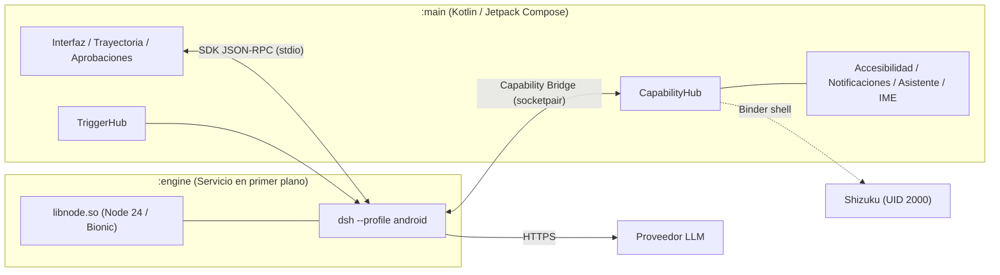

# DSH-Android

Cliente nativo de [DeepSeek Harness](https://github.com/deepseek-ai/deepseek-harness) (`dsh`) para Android. Ejecuta el motor original sobre Node.js 24 embebido y expone las capacidades del teléfono mediante un canal local JSON-RPC.


[Descargar APK](../../releases/latest) | [Inicio rápido](#inicio-rapido) | [Arquitectura](#arquitectura) | [Compilación](#compilacion)

## Inicio rápido

1. Descarga e instala el APK desde [Releases](../../releases/latest) en un dispositivo `arm64-v8a` con Android 10 o superior.
2. Inicia sesión con tu cuenta de DeepSeek o configura una clave de API en Ajustes > Servicios de modelo.
3. Escribe la tarea que necesitas ejecutar. La aplicación solicita cada permiso de Android solo cuando una herramienta lo requiere.
4. Opcional: instala e inicia Shizuku desde Ajustes > Permisos del teléfono para habilitar la pantalla virtual en segundo plano (Agent Screen) en Android 11 o superior.

## Capacidades

La aplicación agrupa las herramientas del dispositivo por dominio funcional:

- Sistema de archivos: búsqueda, organización, compresión y extracción de texto desde documentos PDF, Word, Excel y PowerPoint.
- Control de pantalla y aplicaciones: lectura del árbol de accesibilidad, pulsaciones, gestos, escritura multinivel y apertura directa de actividades.
- Pantalla virtual del agente: ejecución aislada de aplicaciones en segundo plano mediante un display virtual con políticas propias de teclado y audio cuando Shizuku está activo.
- Ajustes y comunicaciones: control de brillo, volumen, modo No molestar, alarmas, Wi-Fi, Bluetooth, lectura y respuesta de notificaciones, consulta de contactos y envío de SMS.
- Automatización: reglas programadas por cron o activadas por eventos del sistema (conexión Wi-Fi o Bluetooth, carga eléctrica, geocercas y notificaciones).
- Proveedores de modelos: soporte nativo para DeepSeek y adaptador compatible con la especificación Chat Completions de OpenAI (OpenAI, Anthropic, Gemini, OpenRouter, Groq y servidores locales).

## Arquitectura



El proceso `:engine` carga `libnode.so` mediante JNI dentro de un servicio de primer plano sin requerir Termux, proot ni permisos root. El código de `dsh` se mantiene sin bifurcar; la integración con Android se inyecta mediante plugins (`@dsh-android/*`) y parches deterministas durante el empaquetado.

## Requisitos del sistema

- Android 10 (API 29) o superior (Android 11+ requerido para Agent Screen).
- Arquitectura `arm64-v8a` (compatible con alineación de página de 16 KB en Android 15).
- 500 MB de almacenamiento libre.

## Compilación

Requisitos del entorno de compilación: JDK 21, Android SDK (`compileSdk 37.2`), NDK r29, Node.js 24 y Python 3.

```bash
# 1. Descargar librerías nativas precompiladas (libnode.so, libdshengine.so, librg.so)
GH_REPO=jackwener/DeepseekHarness-Android native/prebuilt.sh fetch

# 2. Construir el paquete del motor (engine.zip)
OUT_DIR=toolchains/out/engine js/build-engine.sh

# 3. Compilar el APK
./gradlew :app:assembleRelease \
  -Pdsh.nativeOut=toolchains/out/jniLibs \
  -Pdsh.engineOut=toolchains/out/engine \
  -Pdsh.thirdPartyOut=toolchains/out/third-party
```

### Estructura del proyecto

```text
app/                Aplicación Android (Kotlin, Compose, Hilt, Room)
  core/engine/      Gestión del proceso :engine, puente JNI y recuperación ante fallos
  core/capability/  Implementación de herramientas del dispositivo y Agent Screen
  core/trigger/     Motor de reglas y receptores de eventos del sistema
  feature/          Pantallas de conversación, panel rápido, automatización y ajustes
js/                 Perfil de Android, plugins para dsh y parches de empaquetado
native/             Scripts de compilación de Node 24 para Bionic y envoltorio JNI
tools/              Verificación y descarga del paquete oficial de Shizuku
docs/               Documentación de arquitectura, contrato del motor y tokens de diseño
```

### Documentación técnica

- [Arquitectura interna](docs/ARCHITECTURE.md)
- [Contrato del motor (App <-> dsh)](docs/ENGINE-CONTRACT.md)
- [Tokens de diseño](docs/design-tokens.md)

## Licencia

Distribuido bajo la licencia [Apache License 2.0](LICENSE). Los componentes de terceros incluidos (Node.js, DeepSeek Harness, Shizuku, ripgrep y `dsh-llm-service-lite`) mantienen sus respectivas licencias originales.
